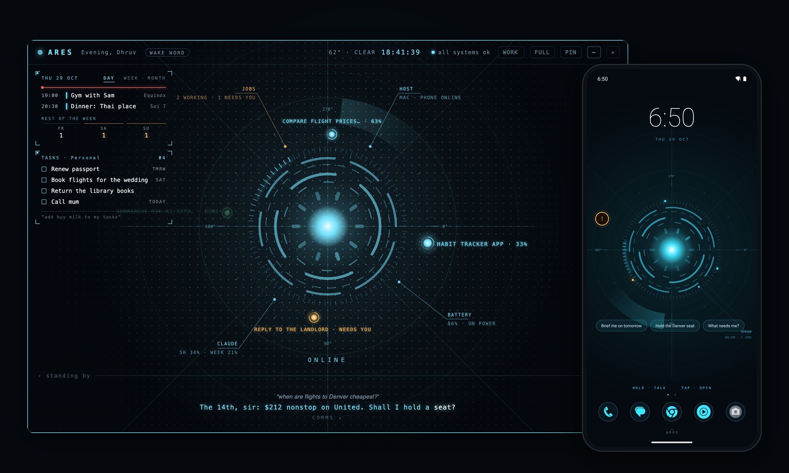
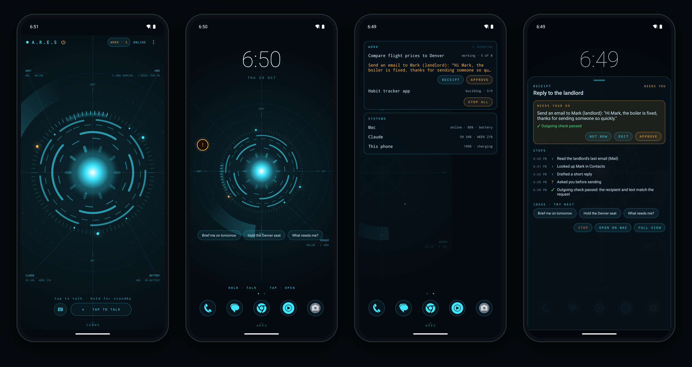
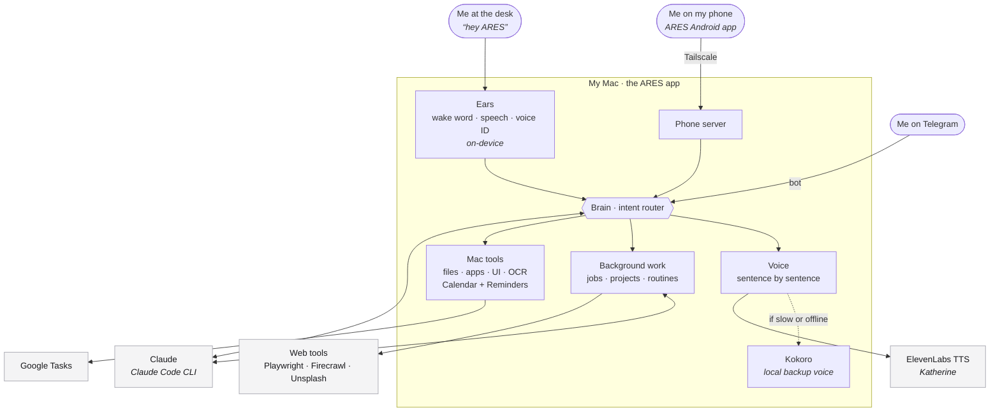
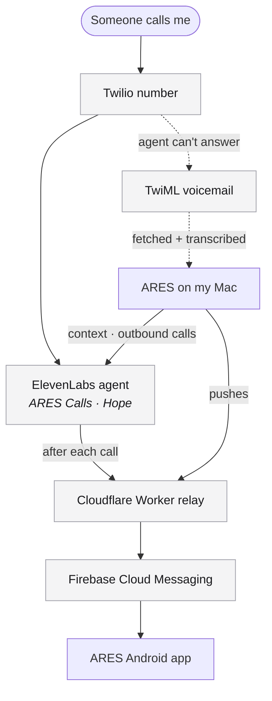

# ARES

My personal assistant. ARES lives on my Mac, follows me to my phone, and answers my phone line when I can't.
I talk to her by voice ("hey ARES"), type to her, or message her, and she gets things done on the Mac for me.



This is a personal project, built for one person (me) on my own machines. It isn't a product and isn't set up
for anyone else to install. I design it, make the product decisions, and test and debug it; Claude Code writes
most of the code under my direction.

<p align="center"></p>
<p align="center"><sub>Waking up: the reactor charges while her services start, then she comes online.</sub></p>

## Highlights

- **She never goes silent.** Her voice streams from ElevenLabs one sentence at a time. If a sentence's audio
  hasn't started within 1.2 s, ARES sends a second request and plays whichever answers first; after 6 s that
  sentence switches to a local voice (Kokoro, about 0.2–0.4 s to first audio), and she switches back by herself.
  In my logs first audio was 0.62 s at the median and 4.06 s at the 95th percentile over 103 sentences.
- **Every failure gets the right response.** Out of credits, a key without permission, a rate limit, a dropped
  stream: each is told apart and handled differently, announced once, and retried on a schedule.
- **Measured, not guessed.** I benchmarked first audio before picking models: 3.07 s for `eleven_v3`, 0.21 s for
  `eleven_v4_turbo` over a WebSocket. I measured that macOS's voice processing silenced other apps' audio
  (0 of 44 test words heard), and the reactor look cut the window's CPU from 23% to 8%.
- **She asks before anything risky.** Every action has a tier. Sending, deleting and paying wait for my own "yes"
  (a fingerprint on the phone), a separate model checks each outgoing message against what I asked for, and
  everything lands in an audit log. One phrase, "stop everything", pauses all background work.
- **Private by design.** Wake word, speech recognition and voice ID run on the Mac. The Mac accepts no connections
  from the internet; the phone reaches it over my own Tailscale network.
- **Real debugging.** One crash took every Electron app on the Mac down at launch. I traced it to the start-up helper
  leaking 399 web processes until macOS ran out of Mach ports, then fixed the leak at its source.

## On the phone



The native Android app and launcher, left to right: the app, the home screen with suggestions, live jobs with an
approval waiting, and the approval itself with each step she took. Screens are shown with made-up data.

## Away from the Mac

My phone works as a remote for the whole Mac, through the paired connection over my own Tailscale network.

### My Claude Code workflow, from my phone

ARES watches every Claude Code session on the Mac: the ones in the Claude desktop app, the ones in a terminal, and
the ones she runs herself.

- **She tells me when one needs me.** A notification arrives when a session finishes a long turn, asks for
  permission, is waiting for an answer, or stops with an error. It has buttons for **Summary**, **Reply** (typed
  straight into the notification) and **Open in Claude**.
- **I can ask how they're doing.** "What are my Claude sessions doing?" gets a list of what each one is busy with,
  and "summarise the portfolio one" says where it got to.
- **I can reply to any of them.** A closed session picks up on the Mac where it stopped. A reply to one that's
  mid-turn waits until the turn ends. She never writes into a session that's open in the desktop app; she offers a
  copy of it instead.
- **I can start new work.** "Start a Claude session in my portfolio to fix the mobile nav" starts one in that folder.
  Through Remote Control she can put a session on my phone so I drive it myself in the Claude app, or open it in
  Terminal on the Mac for when I'm back.
- **Whole projects build while I'm out.** "Build me a habit tracker" becomes a project in its own folder. Claude Code
  builds and tests it, a separate check grades it against a definition of done and sends it back once if it falls
  short, and the finished project arrives on my phone as a zip.
- **It stays inside my limits.** The phone shows how much of my Claude 5-hour and weekly limits is used, and near the
  limit, running projects pause and resume by themselves. Pushing, deploying or publishing always asks me first, and
  STOP ALL on the phone halts everything.

### Files between my phone and my Mac

- **Mac to phone.** "Send that PDF to my phone" sends any file from my folders, and a screenshot or the picture on
  the clipboard work the same way. It arrives as a notification with **Open**, downloads over the paired connection
  into the phone's Downloads, and opens in the right app. Only my paired phone can fetch it, and the link expires
  after 24 hours. Text and links go the same way.
- **Phone to Mac.** I share from any app to ARES: up to five files (PDFs, documents, photos), plus text or a link,
  and say what to do with them. She reads photos straight away, or hands the files to a background job on the Mac.
- **Back at the desk.** OPEN ON MAC on a job puts it on the Mac's screen, or waits until I'm back at the Mac.
- **When the Mac is out of reach.** Requests wait on the phone and go through as soon as the Mac is back.

## How it fits together

**Talking to her.** Every way I reach her ends up at the same brain on the Mac. Grey boxes are outside services.



**My phone line and notifications.** The phone line runs in the cloud, so it works even when the Mac is off.



Everything the Mac does goes out over HTTPS; nothing on the internet can connect in. The phone reaches the Mac
only through my own Tailscale network.

## What she does

- **Talks.** An on-device wake word, speech recognition and voice ID (she only takes commands from me), Claude as
  the brain, and an ElevenLabs voice (Katherine) streamed sentence by sentence so she starts speaking right away.
  If ElevenLabs is slow, out of credits or offline, a free local voice (Kokoro) takes over mid-sentence.
- **Works on the Mac.** Files in my folders, windows, apps, the calendar and reminders, OCR and PDFs, and step-by-step
  UI automation. Each action has a tier: simple things she just does; risky ones (sending, deleting, paying) wait
  for my own "yes", and everything goes in an audit log.
- **Runs jobs in the background.** Research and writing jobs, whole coding projects in their own folders (checked
  against a definition of done before she calls them finished), multi-step goals, and routines on a schedule. One
  phrase, "stop everything", pauses all of it.
- **Runs my Claude Code sessions.** Alerts, summaries, replies, new sessions and Remote Control, from anywhere
  (see [Away from the Mac](#away-from-the-mac)).
- **Moves files between my phone and Mac.** Either way, over the paired connection.
- **Is on my phone.** A native Android app and home-screen launcher: a floating bubble, hold-to-talk, cards,
  live job progress in the status bar, and approvals with my fingerprint.
- **Answers my phone.** A separate ElevenLabs agent on a Twilio number takes calls when I can't, sends me the caller,
  topic and callback number, and can place calls for me. If the agent is down, callers get a voicemail and ARES
  transcribes it.
- **Has a look.** An arc-reactor interface with panels for the calendar, tasks and jobs, plus power states: standby,
  power down and a charge-up on wake, mirrored on the phone.

## What's in the repo

| Folder | What |
|---|---|
| `src/` | The Mac app (Electron: Node.js + Chromium). `main.js` and the other files hold the services; `renderer/` is the interface, `tools/` the brain's tools, `phone/` the phone's web page. |
| `native/` | Swift helpers: the microphone and wake word, Mac control (Accessibility, input, OCR), calendar/EventKit, camera, and the start-up screen. |
| `android/` | The Android app and launcher (Kotlin). See [android/README.md](android/README.md). |
| `relay/` | The Cloudflare Worker for push notifications and waking the Mac. See [relay/README.md](relay/README.md). |
| `scripts/` | Build scripts and tests. |
| `models/` | The small on-device models (intents, voice ID). The big ones are downloaded, not committed. |
| `docs/` | The design brief for each feature (`docs/*-prompt.md`). `CLAUDE.md` has the working notes. |

## Running it

On my Mac (Apple silicon):

```bash
npm install
cp .env.example .env    # then fill in the keys I use
npm start               # a development build; it speaks with the free local voice
npm run build           # builds, signs and installs ARES.app
```

It needs the Xcode command-line tools (for the Swift helpers), Node.js, and the Claude Code CLI signed in.
ElevenLabs, Twilio, Telegram and the relay are optional: anything without a key is simply switched off.
The backup voice model is downloaded once by `scripts/get-voice-model.sh`.

Tests live in `scripts/test-*.js`. They use fakes and mocks, so they don't spend Claude usage or ElevenLabs credits.

## Privacy

- Listening, the wake word and voice ID stay on the Mac. Speech that isn't meant for her is never stored or sent anywhere.
- The Mac accepts no connections from the internet. The phone reaches it over Tailscale; everything else goes out over HTTPS.
- Keys live in `.env` (never committed) and the macOS Keychain. Session text sent to my phone is cleaned by `redact.js` first.
- Phone calls are kept as transcripts only, with no audio recorded.
